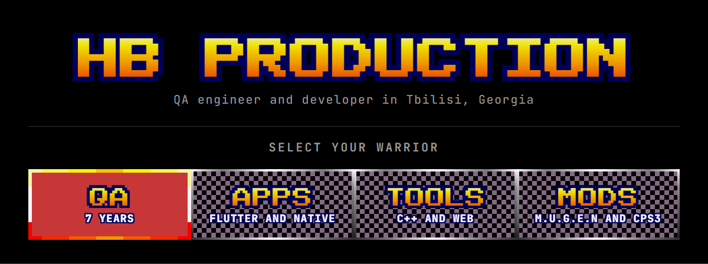
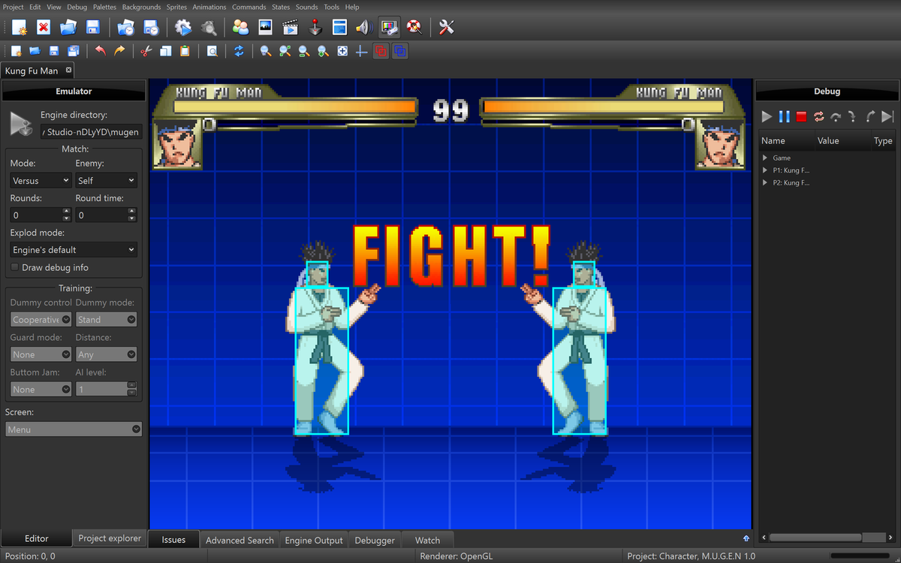
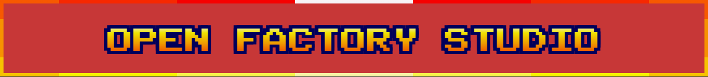
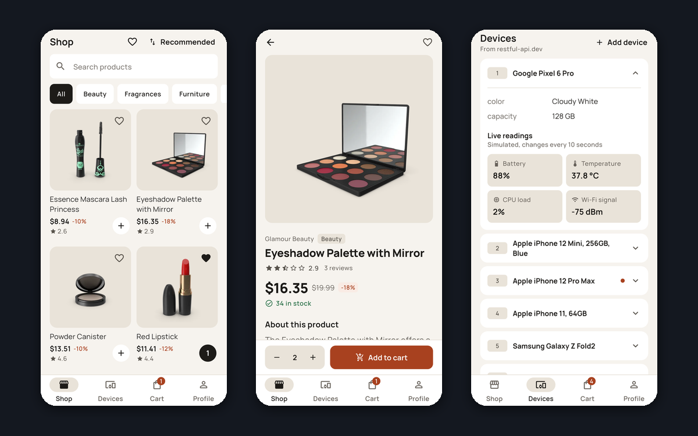
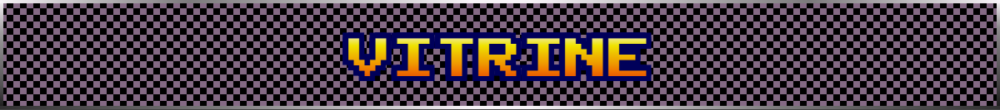
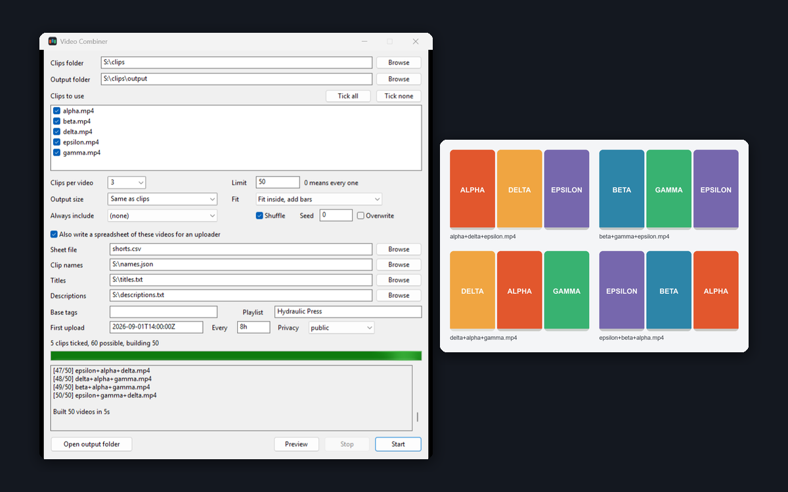
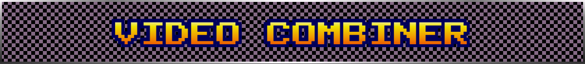
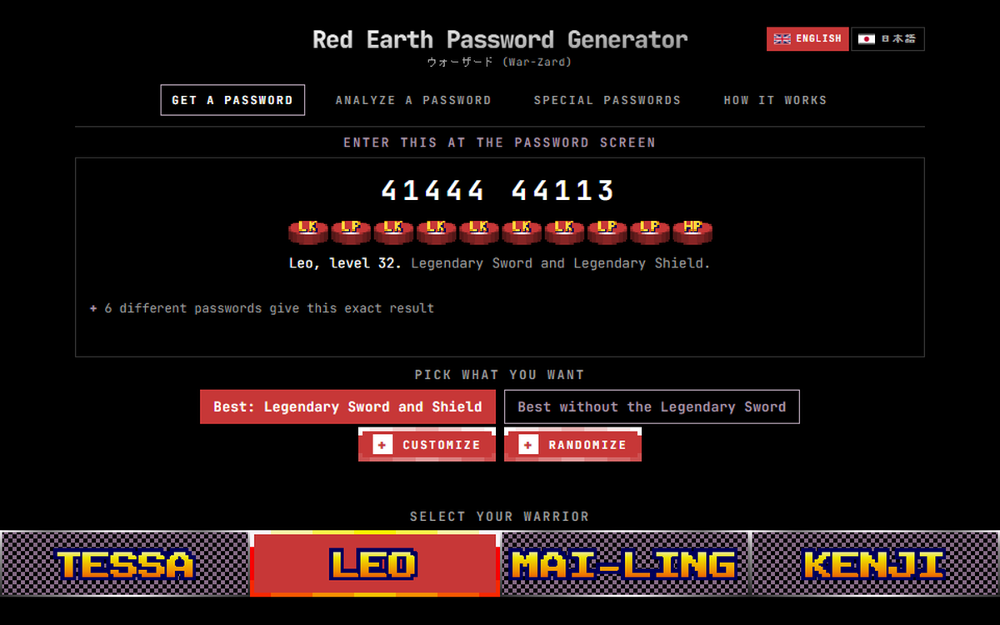
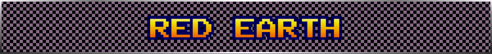
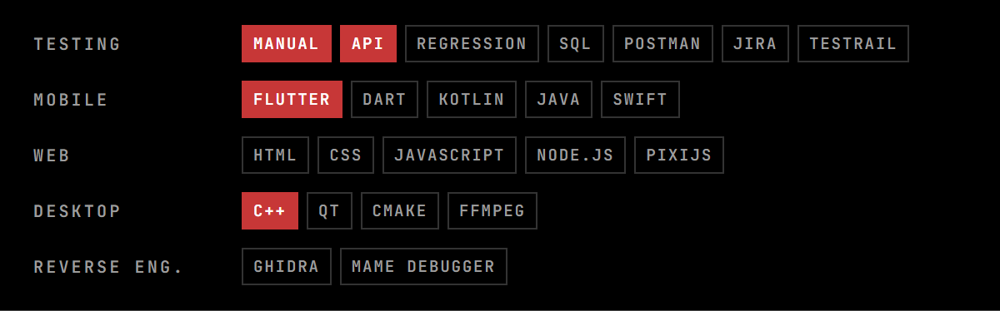

Seven years of software testing: games at Golden Fox, then the systems behind the Aversi pharmacy chain, where I also wrote the SQL. Outside work I build apps, desktop tools and fighting game mods.

Testing is the main job. Playwright with TypeScript is what I'm learning now.

<table>
  <tr>
    <td width="50%" valign="top">
      
       Edit M.U.G.E.N characters, stages and screenpacks, then try them in the emulator that comes with it. The layout follows Fighter Factory Studio 3.7.
       C++20, Qt 6, Windows and Linux
    </td>
    <td width="50%" valign="top">
      
       A shop, a cart and a live device list, unlocked with your fingerprint or face. It started as a job application task in 2025, and I rebuilt it from scratch a year later.
       Flutter, Riverpod, Dio, tests in CI
    </td>
  </tr>
  <tr>
    <td width="50%" valign="top">
      
       Point it at a folder of clips and every combination becomes a video. Five clips at three per video give you 60.
       C++17, ffmpeg, Windows app and command line
    </td>
    <td width="50%" valign="top">
      
       Pick a warrior and the gear, get the password. I took the rules from a disassembly of Capcom's 1996 arcade game, and all 225 published passwords decode.
       HTML, CSS, JavaScript, English and Japanese
    </td>
  </tr>
</table>

Also here: [YouTube Auto Uploader](https://github.com/HBProductionOfficial/Youtube-Automatic-Uploader), a Google Apps Script that publishes scheduled videos from Google Drive, with a Google Sheet as the queue and titles in 38 languages.

M.U.G.E.N mods made with a small modding team, Red Earth TAS runs, and my Red Earth ROM hack, all on the HB Production YouTube channel.
